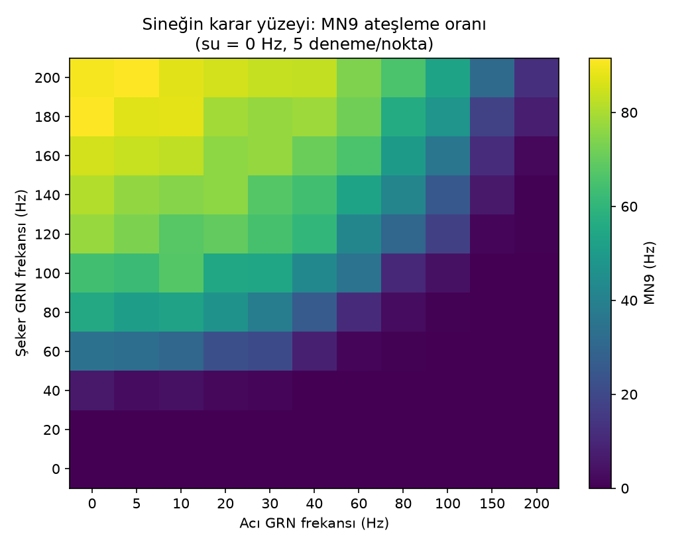

# Sinek beyni modülü: doğrulama raporu (Faz 1)

Tarih: 14 Ekim 2026, güncelleme 15 Ekim 2026 (GRN eşlemesi) · Connectome: FlyWire v783 (138.639 nöron, 15.091.983 bağlantı) ·
Model: Shiu et al. 2024 LIF, kendi PyTorch uygulamamız (`src/flyhire/brain/lif_torch.py`)

## 1. Nöron kimlikleri (v630 → v783)

Shiu'nun listeleri FlyWire v630 kök ID'leri. v783'te:

| Kanal | Shiu listesi | v783'te aynen bulunan | Eşlenen (CAVE) | Modelde |
|---|---|---|---|---|
| Şeker GRN | 21 | 20 | `720575940620900446` → `720575940639259967` | 21 |
| Su GRN | 18 | 18 | - | 18 |
| Acı GRN | 21 | 20 | `720575940618600651` → `720575940619072513` | 21 |
| MN9 (okunan) | `720575940660219265` | aynen var | - | |
| MN9 (karşı taraf) | `720575940645521262` | yok | aynı hücre tipinden (CB0701): `720575940618238523` | |

Kanallar 21/18/21 nöronla çalışıyor (`neurons.V783_REPLACEMENTS`). Bu sayılar
`tests/test_brain_full.py::test_channel_coverage` ile sabitlendi. 15 Ekim 2026'dan önceki sonuçlar
(eski karar yüzeyi `data/surface_v783_grn20-18-20.npz`, §3 tablosu) eşleme yapılmadan, 20/18/20 nöronla
alındı.

### Eksik GRN'lerin v783 karşılıkları (CAVE)

`scripts/map_missing_grns.py` (`flywire_fafb_public`, `get_latest_roots` / `suggest_latest_roots`,
v783 zaman damgası; `get_past_ids` ile v630'a geri):

| Kanal | v630 ID | v783 ID | Değişiklik | Örtüşme | Listede mi? | v783 tipi |
|---|---|---|---|---|---|---|
| Şeker | `720575940620900446` | `720575940639259967` | birleşme (v630'daki 5 kök tek nörona) | 1,000 | hayır | LB3c, sugar |
| Acı | `720575940618600651` | `720575940619072513` | birleşme (v630'daki 3 kök tek nörona) | 1,000 | hayır | LB1c, bitter |

İki durumda da bölünme yok: eski kök tamamen tek bir v783 köküne geçmiş ve proofreading ile başka
parçalarla birleşmiş. Birleşen diğer v630 kökleri hiçbir kanal listesinde değil. Yeni ID'ler modelde
var, annotasyon tipleri kanalla uyumlu.

Eşlenen nöronlar kanallarının güçlü üyeleri: yeni şeker GRN'inin giden sinaps sayısı 557 (kanalda
19./21, medyan 348), yeni acı GRN'ininki 302 (15./21, medyan 158). Birleşme ile büyüdükleri için
v630'daki parçalarından daha fazla bağlantı taşıyor olabilirler.

### Bir GRN'in etkisi

**Deney 1, eşlemeden önce (20 → 19 nöron).** 20 nöronlu kanaldan rastgele bir nöron çıkarılıp MN9
karşılaştırıldı. Üç farklı nöron, her nokta 10 deneme, GPU (`scripts/grn_ablation.py`, ham sonuç
`data/grn_ablation_20.json`). Fark = 19 nöron − 20 nöron; gürültü = farkın standart hatası.

| Çıkarılan | Nokta | 20 nöron (Hz, ort. ± SD) | Fark, 3 farklı nöron (Hz) | Gürültü (SE, Hz) |
|---|---|---|---|---|
| şeker | şeker 60 | 25,5 ± 5,4 | −0,9 / +1,2 / +0,1 | ± 2,1–2,5 |
| şeker | şeker 100 | 61,0 ± 5,8 | −1,9 / −2,1 / −1,0 | ± 2,2–2,8 |
| şeker | şeker 200 | 86,8 ± 7,6 | +0,4 / +1,9 / +2,1 | ± 2,7–3,2 |
| şeker | şeker 100 + acı 30 | 48,3 ± 6,8 | −4,7 / −4,0 / −1,0 | ± 2,3–2,8 |
| şeker | şeker 60 + su 80 | 59,1 ± 5,7 | −1,7 / +2,1 / +2,7 | ± 2,6–3,6 |
| acı | şeker 100 + acı 30 | 48,3 ± 6,8 | −4,7 / +0,6 / +1,4 | ± 2,7–2,9 |
| acı | şeker 100 + acı 60 | 23,8 ± 7,1 | −0,6 / +5,6 / −2,0 | ± 2,8–3,2 |

Çıkarılan nöronlar: şeker `…628853239`, `…640649691`, `…612670570`; acı `…614281266`,
`…645743412`, `…619028208` (hepsi `720575940` ile başlar). 21 karşılaştırmanın yalnızca biri
|fark/SE| = 2,0 sınırına ulaştı.

**Deney 2, eşlemeden sonra (21 → 20 nöron).** Aynı script, aynı noktalar, T4 GPU (Colab), ham sonuç
`data/grn_ablation_21.json`.

| Çıkarılan | Nokta | 21 nöron (Hz, ort. ± SD) | Fark, 3 farklı nöron (Hz) | Gürültü (SE, Hz) |
|---|---|---|---|---|
| şeker | şeker 60 | 36,1 ± 8,5 | −0,5 / −1,5 / **−8,1** | ± 3,1–3,7 |
| şeker | şeker 100 | 68,7 ± 4,0 | −1,4 / −0,2 / **−5,6** | ± 1,5–2,2 |
| şeker | şeker 200 | 91,1 ± 4,6 | **+4,8** / −2,2 / −1,0 | ± 1,8–2,3 |
| şeker | şeker 100 + acı 30 | 52,6 ± 5,3 | −1,9 / −3,0 / **−8,4** | ± 2,0–2,9 |
| şeker | şeker 60 + su 80 | 62,5 ± 6,5 | −0,6 / +1,3 / +1,9 | ± 2,5–2,9 |
| acı | şeker 100 + acı 30 | 52,6 ± 5,3 | +1,6 / +1,7 / −1,9 | ± 2,3–2,4 |
| acı | şeker 100 + acı 60 | 29,1 ± 2,4 | +0,1 / **+9,6** / +2,8 | ± 1,8–2,5 |

Çıkarılan nöronlar: şeker `…612670570`, `…640649691`, `…632425919`; acı `…619028208`,
`…610483162`, `…610259370`. Kalın değerler |fark/SE| ≥ 2 (21 karşılaştırmanın 5'i; şans eseri ~1
beklenir). Büyük etkiler iki nörondan geliyor: şeker `…632425919` (522 sinaps, kanalda 18./21) üç
noktada 5–8 Hz düşürüyor, acı `…610483162` (440 sinaps, kanalın en güçlüsü) acı 60 Hz'de baskılamayı
belirgin biçimde zayıflatıyor. Sinaps sayısı tek başına açıklamıyor: deney 1'deki `…628853239` da
güçlü (495 sinaps) ama etkisi küçüktü.

**Deney 3, karar yüzeyinin tamamı.** 21/18/21 ile yeniden hesaplanan yüzey (§5) eski 20/18/20 yüzeyiyle
726 noktada karşılaştırıldı (her ikisi 5 deneme/nokta):

| | Değer |
|---|---|
| Ortalama fark (yeni − eski), MN9 > 5 Hz olan 559 nokta | **+2,0 Hz**, noktaların %69'unda pozitif |
| Ortalama mutlak fark, tüm noktalar | 2,7 Hz |
| \|fark/SE\| > 2 olan nokta | 118 / 726 (şans eseri ~40–60 beklenir); 91'i pozitif yönde |
| En büyük fark | +14,8 Hz (şeker 100, acı 10), +14,0 Hz (şeker 40, su 160) |

Şeker seviyesine göre ortalama fark: şeker 0–20 Hz'de ~0, şeker 40–60 Hz'de +1,5, şeker 80–200 Hz'de
+2–3 Hz.

**Sonuç:** Deney 1'in "bir GRN'in etkisi gürültü düzeyinde" sonucu genellenemiyor. GRN'lerin katkısı
nörondan nörona çok değişiyor; rastgele seçilen üç nöron bunu yakalamaya yetmedi. Eşlenen iki nöron
birlikte MN9'u sistematik olarak ~2 Hz artırıyor, eşik bölgesinde 10–15 Hz'e kadar. Bu yüzden eşlemeli
21/18/21 kanallar ve yeniden hesaplanan yüzey kullanılıyor; tüm sonraki ölçümler bu yüzeye göre.
Kanal tanımı brain_version etiketine girdiği için (`grn21-18-21/…`) eski yüzey yanlışlıkla
kullanılamaz.

**Tipleme farkı:** v783 annotasyonları (Schlegel et al. 2024) Shiu'nun "şeker" listesinde LB3d
(yüksek tuz) ve LB4b, "su" listesinde LB3c (şeker) tipleri gösteriyor. Makalede doğrulanmış davranışı
korumak için Shiu listeleri kullanıldı; tiplemeye dayalı kanallar Faz 5'te kontrol olarak denenebilir.

## 2. PyTorch modelinin Brian2 ile eşdeğerliği

Brian2 referansı: `src/flyhire/brain/lif_brian2.py` (Shiu `model.py` temelli, MIT).

| Test | Sonuç |
|---|---|
| Küçük rastgele ağ (300 nöron), deterministik girdi, 2 s, **float64** | 37.874 spike, **tüm nöronlarda birebir aynı sayı** (CPU ve GPU) |
| Aynı test, float32 | toplam aynı, 24 nöronda ±1–2 spike fark (yuvarlama) |
| Aynı ağ, Poisson girdi, 400 / 150 deneme | uyarılmayan nöronların toplam oranı 639,4 ± 2,4 / 636,9 ± 3,8 Hz |
| **Tam beyin**, şeker 200 Hz, torch 20 / Brian2 5 deneme | aktif 406 nöron, korelasyon **0,9992**, toplam oran 16.170 / 16.191 Hz, MN9 **89,7 / 89,8 Hz** |

Deterministik eşdeğerlik testi hızlı test paketinde (`test_matches_brian2_exactly_with_deterministic_input`,
float64). Varsayılan hesap float32'dir: Brian2 float64 kullandığı için eşiğe çok yakın durumlarda
yuvarlama tek tek spike'ları değiştirebilir; ortalamalar etkilenmez. İlk "birebir aynı" sonucu float32
ile torch 2.14'te alınmıştı; torch 2.11'de 1 s sonra birkaç spike ayrıştı. Bu yüzden birebir test
float64'e taşındı.

### Bulunan ince nokta: refrakter sürede sinaptik girdi
İlk sürümde aşağı akış nöronları %5–12 fazla ateşliyordu. Sebep: Brian2, `(unless refractory)`
işaretli değişkenlere **koşullu yazma** uygular. Refrakter (veya o adımda spike atmış) bir nörona gelen
`g += w` sinaptik girdisi geldiği anda **yok sayılır**; yalnızca türev dondurulmaz. Bu davranış küçük
bir Brian2 deneyiyle ve Brian2 2.10 kaynak koduyla (`NeuronGroup`, `set_conditional_write`)
doğrulandı. PyTorch modeli aynı kuralı uygular.

## 3. Biyolojik sonuçların tekrar üretilmesi

Tam beyin, 1 s sanal süre. İlk sütun eşlemeden önce (20/18/20, CPU, 10 deneme), ikinci sütun
eşlemeden sonra (21/18/21, karar yüzeyinin ızgara noktaları, 5 deneme):

| Girdi | MN9, 20/18/20 (Hz) | MN9, 21/18/21 (Hz) | Beklenen (Shiu 2024) |
|---|---|---|---|
| Girdi yok | 0,0 | 0,0 | sessiz |
| Şeker 100 Hz | 57,6 ± 4,6 | 63,8 ± 4,0 | ateşler |
| Şeker 200 Hz | 92,1 ± 6,9 | 90,4 ± 3,3 | ateşler, frekansla artar |
| Şeker 100 + acı 100 Hz | **2,6 ± 1,7** | **4,2 ± 3,0** | acı şeker yanıtını baskılar |
| Şeker 100 + acı 200 Hz | 0,0 | 0,0 | |
| Su 200 Hz | 31,7 ± 4,3 | 30,4 ± 3,2 | ateşler |
| Acı 200 Hz | 0,0 | 0,0 | ateşlemez |

Eşleme Shiu'nun nitel sonuçlarını değiştirmiyor.

Kalıcı testler: `pytest -m slow` (yerelde 16 çekirdekte yaklaşık 1 dakika). 21/18/21 kanallarla Colab'da
5/5 geçti (2 çekirdekli CPU'da 4 dk 21 s).

**Kodlayıcı için not (Faz 3):** acı çok güçlü bir baskılayıcı. Şeker ile aynı frekanstaki acı, MN9'u
neredeyse tamamen susturuyor. Acı kanalının ölçeği bu yüzden şekerinkinden çok daha küçük seçilmeli;
karar yüzeyinde acı ekseni düşük frekanslarda sık örneklendi.

## 4. Performans (CPU, 16 çekirdek)

| | Süre |
|---|---|
| Connectome yükleme | 0,6 s |
| PyTorch, 1 s sanal süre | **1,45 s / deneme** (batch 10–30) |
| Brian2 (cython), 1 s sanal süre | ~48 s / deneme (ağ kurulumu dahil) |
| **GPU** (RTX 4060 Laptop, torch 2.11+cu128), float32, batch 120–300 | **0,41–0,44 s / deneme**, 0,8 GB bellek |
| GPU, float32, batch 30 | 0,69 s / deneme |
| GPU, float64, batch 120 | 0,84 s / deneme |
| CPU, torch 2.11 (CUDA paketi), batch 30 | 2,5 s / deneme |
| **Colab T4** (ücretsiz), float32, batch 120 | ~0,6 s / deneme (462 yüzey noktası × 5 deneme ≈ 23 dk) |

GPU ve CPU aynı noktada tutarlı: şeker 60 Hz, 30 deneme → GPU 26,8 / 27,8 Hz, CPU 27,9 / 27,6 Hz
(iki seed, SE ≈ 1,1).

İlk PyTorch sürümü 3,8 s/deneme idi. Refrakter nöronları tüm dizi üzerinde maske yerine yalnızca son
spike'lar üzerinden izlemek 2,6× hızlandırdı (`v_rst = v_0` ve refrakterde `g = 0` olduğu için bu
nöronlar zaten dinlenme noktasında).

Karar yüzeyi (726 nokta × 5 deneme) CPU'da 81 dakika sürüyor. Uzun CPU koşuları dizüstü bilgisayarı
zorladığı için ağır hesaplar artık `notebooks/colab_brain.ipynb` ile Colab'da (T4 GPU) yapılıyor;
sonuçlar Drive'a yazılıyor ve hesap kaldığı yerden devam ediyor. İlan başına tam simülasyon (5 deneme)
CPU'da yaklaşık 7 saniye.

## 5. Karar yüzeyi

`data/surface_v783.npz`: şeker 0–200 Hz (11 nokta) × su 0–200 Hz (6) × acı 0–200 Hz (11, düşük
frekanslarda sık), nokta başına 5 deneme, 1 s, kanallar 21/18/21. 264 nokta yerelde (CPU), kalan 462
nokta Colab T4'te hesaplandı; batch seed'i ilk noktaya bağlı olduğu için devam eden hesap aynı
sonucu verir (yerelde hesaplanan noktalar Colab dosyasında birebir aynı). Eski 20/18/20 yüzeyi
`data/surface_v783_grn20-18-20.npz` olarak saklandı (farklar §1, deney 3).

Yüzeyden çıkan, basit bir toplamla açıklanamayacak davranışlar:

- **Şeker eşiği:** 40 Hz'e kadar MN9 neredeyse sessiz (6 Hz), 60 Hz'de 35 Hz'e sıçrıyor.
- **Su tek başına zayıf, şekeri güçlendiriyor:** su 120 Hz'e kadar MN9'u ateşlemiyor (200 Hz'de 30 Hz),
  ama şeker 60 Hz'in yanında su 80 Hz yanıtı 35'ten 66 Hz'e çıkarıyor.
- **Acı baskılaması şekere bağlı:** düşük şekerde az acı yetiyor, yüksek şekerde çok daha fazlası gerekiyor.
  Su 120 Hz'de şeker eşiği ~20 Hz'e iniyor ve acıya tolerans artıyor
  ([görsel](figures/decision_surface_water120.png)).

Bunlar Faz 5'te "sinek ile basit kural nerede ayrışıyor?" sorusunun aday cevapları.

### İnterpolasyon hatası

`flyhire brain check-surface --points 24`: ızgara dışındaki 24 rastgele noktada yüzey (doğrusal
interpolasyon) ile gerçek simülasyon (5 deneme) karşılaştırıldı (21/18/21: Colab T4, `--device cuda`).

| | 20/18/20 yüzeyi | 21/18/21 yüzeyi |
|---|---|---|
| Ortalama mutlak hata | 2,1 Hz | **1,7 Hz** |
| En büyük hata | 6,0 Hz | 5,8 Hz |
| Simülasyonun kendi denemeler arası sapması | ± 0–7 Hz | ± 0–8 Hz |

21/18/21 yüzeyinde en büyük hata eşik bölgesinde (şeker 68, su 52, acı 71: yüzey 15,6, simülasyon
9,8 ± 3,1 Hz). Yüzey 24 noktanın 18'inde simülasyondan biraz yüksek; ortalama sapma +1,0 Hz.

Hata, simülasyonun kendi gürültüsüyle aynı büyüklükte. Günlük kararlar yüzeyden okunabilir; eşiğe
yakın ilanlar (panelde "kararsız") için tam simülasyon çalıştırılmalı.
